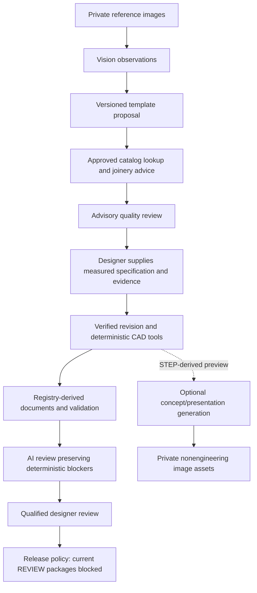

# Current photo-to-3D workflow

Use [PHOTO_RECONSTRUCTION.md](PHOTO_RECONSTRUCTION.md) for upload analysis, matching optional input fields, supplied-value constraints and photo-specific geometry. The measured cabinet workflow described below remains available through its existing APIs.

# Collaborative furniture design API — review prototype

This extends the existing application. The deterministic Python orchestrator coordinates seven specialist modules; the OpenAI Responses API supplies Vision, Design, Joinery, Quality Review and optional image generation. CAD and Manufacturing Documentation specialists call the existing Python engines. The separate OpenAI Agents SDK is **not** a dependency: the requested deterministic-orchestrator option is used to keep transitions, retries and verification under application control.

## Setup and model selection

Run `uv sync --frozen` and `python -m alembic upgrade head` in the configured environment. Existing cabinet endpoints work without OpenAI configuration. In a local workspace, AI and CAD requests run on a bounded serial background queue inside the API process. Redis and a separate worker are unnecessary. Shared deployments use the existing Celery worker; eager execution is confined to smoke tests and automated tests.

Configure `AI_ENABLED=1` and `OPENAI_API_KEY` in the **backend environment/secret manager**, then set role models. No API key is accepted from a client request or stored in workflow snapshots, audit events or source code. Model identifiers have no hardcoded runtime defaults.

| Environment setting | Purpose |
| --- | --- |
| OPENAI_VISION_MODEL | Image observations and required measurements |
| OPENAI_DESIGN_MODEL | Supported template proposal |
| OPENAI_JOINERY_MODEL | Read-only factory-catalog recommendations; uses design model when blank |
| OPENAI_REVIEW_MODEL | Advisory pre/post-CAD review |
| OPENAI_RENDER_MODEL | Mainline Responses model coordinating the image tool; uses design model when blank |
| OPENAI_IMAGE_MODEL | Image-generation tool model |
| OPENAI_FALLBACK_MODEL | Optional explicit fallback after access/rate-limit failures |
| OPENAI_TIMEOUT_SECONDS | Per-request timeout, default 90 seconds; supported range 1–600 |
| AI_MAX_OUTPUT_TOKENS | Per structured response limit, default 6000 |

`gpt-4.1` is a documented example with image input, Responses and Structured Outputs support; it is not selected automatically. A documented image tool example is `gpt-image-1.5`. Choose models available to your account and suitable for the task. The worker calls `models.retrieve` before using a configured identifier and then validates actual Responses compatibility. **Account availability and live task quality have not been checked here because no API key was configured.** More capable reasoning models can be configured without changing specialist code.

Implementation sources checked on 18 October 2026: [OpenAI Structured Outputs](https://developers.openai.com/api/docs/guides/structured-outputs?api-mode=responses), [function calling](https://developers.openai.com/api/docs/guides/function-calling), [Responses image generation](https://developers.openai.com/api/docs/guides/tools-image-generation), and [GPT-4.1 modalities](https://developers.openai.com/api/docs/models/gpt-4.1). Documented support does not establish access for a particular account.

For the prepared password-free Windows workspace, add the backend key to the local `.env`, retain `LOCAL_WORKSPACE=1` and `JOB_EXECUTOR=local`, then start one API process:

```powershell
uv run --no-sync --env-file .env python -m uvicorn app.main:app --reload
```

For a shared deployment set `JOB_EXECUTOR=celery`, run Redis and a Celery worker with the same backend configuration as the API. Windows workers use `python -m celery -A app.jobs.celery_app worker --pool=solo --concurrency=1 --loglevel=INFO`. Compose forwards these settings from `.env`; retain `.env` outside source control. `GET /api/v1/ai/configuration` returns safe configuration status, the selected executor and CAD tool schemas, never credentials. Orchestration is deterministic and makes no orchestrator-model calls.

If an existing local workflow failed with HTTP 503 / `AGENT_QUEUE_UNAVAILABLE` because Redis was unavailable, restart with local execution, refresh its project and choose **Retry workflow**. Completed checkpoints and uploaded references are reused. No failed paid workflow is automatically replayed.

## Controlled data flow



AI concept/presentation outputs cannot be submitted as design evidence through the API. They can be viewed as visual concepts. Uploaded reference images and server-created CAD previews can enter analysis; neither supplies verified millimetre measurements. Image generation is never a CAD dependency.

Specialists exchange Pydantic-validated objects. Proposed parameters are limited to supported cabinet fields. They remain IMAGE_OBSERVED or AI_ESTIMATED; no model output can set DESIGNER_VERIFIED, FACTORY_APPROVED, engineering certification, approval or release. A single rectangular cabinet template (`cabinet.v1`) is supported. Shelves, drawers, legs, multiple glass panels/doors and explicitly unrepresented features require custom review.

The Joinery Agent can call only `lookup_approved_joinery`, with a strict material-list schema. The server rechecks every suggested profile ID against the frozen approved, evidence-referenced catalog and candidate materials. Recommendations do not apply machining features. Actual joint geometry still uses the existing approved-profile engine and its blockers. There are no Python, shell, filesystem or release tools available to LLMs.

## API sequence

All routes require an authenticated identity and existing project access. Trusted same-origin loopback requests in local workspace mode use its password-free designer identity; shared deployments use bearer sessions. Project owners, assigned designers and admins can read project artifacts; write/signoff roles follow the existing policy. A design ID below is the **collaborative workflow UUID**; its separately generated revision ID is returned after verification.

1. Create a project using the existing API. Upload one reference at a time to `POST /api/v1/projects/{project_id}/images` as multipart field `file`. Supply up to six returned image IDs to analysis. PNG/JPEG/WebP are decoded and re-encoded as metadata-stripped PNGs. Single-image input limit is 1500 KiB; the HTTP limit remains 2 MiB. Animations, SVG, invalid raster data and excessive pixels/dimensions are rejected. Images are private at `GET /api/v1/images/{image_id}` and hash-checked on read.
2. `POST /api/v1/ai/analyze-image` runs Vision only. `POST /api/v1/ai/generate-design` and `POST /api/v1/agents/run-workflow` run the controlled Vision → Design → Joinery → Review chain. Body:

```json
{
  "project_id": "PROJECT_UUID",
  "image_ids": ["IMAGE_UUID"],
  "notes": "Reference appearance only; measurements will be supplied separately",
  "max_corrections": 0,
  "idempotency_key": "client-request-001"
}
```

These are UUID placeholders. Use actual IDs returned by the API. To reuse completed image observations, pass `source_workflow_id` from analysis and omit `image_ids`. The source must be in the same project and its image/checkpoint hashes must match. This avoids another Vision call.

3. Poll `GET /api/v1/agents/workflows/{id}` for state, stage, progress, typed results, known token/image usage and estimated cost. `GET .../{id}/events?after_id=0` returns up to 500 ordered events; poll with the last ID to continue. Events record stage hashes, selected models, tool calls, decisions, verification and errors; they do not store hidden model reasoning or image base64. The final proposal is `WAITING_FOR_DESIGNER` or `CUSTOM_DESIGN_REVIEW_REQUIRED`.
4. A designer calls `POST /api/v1/designs/{id}/verify` with `VerifiedFurnitureSpecification`: a complete `specification` object, `measurements` and `designer_comment`. Every critical field must be explicitly supplied. Each measurement has `field`, `value_mm`, `provenance` and a nonempty `evidence_reference`. External width/depth/height require PHYSICALLY_MEASURED evidence. Other design dimensions may reference measured stock, factory data or documented user design intent, all explicitly verified by the designer. AI_ESTIMATED is rejected. Values must equal the submitted specification; duplicates, missing records, implicit legacy defaults and unsupported proposals are rejected.

Required fields for a carcass: width_mm, depth_mm, height_mm, panel_thickness_mm, back_thickness_mm. A glazed door also requires door_frame_width_mm, door_frame_depth_mm, glass_thickness_mm, door_perimeter_gap_mm, glass_edge_clearance_mm and door_standoff_mm. Catalog material/hardware/joint snapshots use the same existing catalog rules. Missing engineering data continues to block manufacturing even when dimensional design intent is verified.

Verification creates a new immutable design revision, records per-value source evidence and designer identity, and binds verification to its specification hash. It never promotes the original AI proposal into a verified object. Admin access alone does not permit engineering signoff. To change an already verified AI design, start a new workflow/reuse its observations and create a new verified revision.

5. `POST /api/v1/designs/{id}/generate-cad` queues the existing CAD worker. Both HTTP service and worker check the exact revision hash and active designer verification. The legacy revision-job path enforces the same check for AI-origin revisions. The worker generates actual component solids and STEP/GLB/STL exports, then delegates drawings and schedules to the existing engines. Frozen specification/context mismatch is rejected before package files are written.
6. On CAD completion, the orchestrator resumes for post-CAD Quality Review. The review includes original reference images, parts, schedules, drawing manifest and the immutable deterministic report. Every deterministic ERROR/BLOCKER is copied into the advisory review at its original severity, regardless of the model's response. `REVIEW_REQUIRED` is expected with this template's outstanding engineering requirements. A failed AI review does not invalidate or delete a successfully generated CAD package; resume the workflow to retry only the unfinished review.
7. `POST /api/v1/designs/{id}/validate` verifies artifact integrity and returns the existing deterministic report for that immutable job. It does not rerun unchanged geometry or let the AI replace the report. `POST /api/v1/designs/{id}/approve` accepts the existing `{decision, comment}` review body. `/release` delegates to the existing release policy. Current REVIEW packages cannot be approved/released for manufacture. The CHANGES_REQUESTED review path is available.

`POST /api/v1/ai/review-design` can independently review an existing completed revision using `{project_id, revision_id, image_ids}`. It cannot alter revision state or suppress deterministic findings.

## Concepts and CAD-backed presentations

`POST /api/v1/ai/generate-concepts` accepts `{project_id, prompt, image_ids?, quality?, size?}`. It uses the Responses `image_generation` tool; no CAD is required. Reference-image editing is used when references are supplied. Supported request sizes are 1024x1024, 1024x1536 and 1536x1024; quality is low/medium/high. One image-generation tool call is permitted per response.

`POST /api/v1/ai/generate-render` accepts `{project_id, revision_id, prompt, quality?, size?}`. It freezes the matching CAD job/specification, verifies hashes and rasterizes the **reopened STEP** into a CAD_PREVIEW asset. That preview is supplied to the image tool; client replacement references are rejected. The generated AI_PRESENTATION records source revision, specification hash, job, STEP hash and original CAD-preview record. A preview/presentation image is never authoritative manufacturing geometry. An approved-design state, if available in a future qualified template, is recorded without turning the generated bitmap into approval evidence.

Images remain distinct kinds: REFERENCE, CAD_PREVIEW, AI_CONCEPT and AI_PRESENTATION. Generated images can drift from the source geometry, so presentation fidelity requires human review. No photorealistic output was generated or verified during this execution.

## Reliability and usage accounting

Workflow inputs and model selections are frozen; completed stage checkpoints carry hashes and are reused on retry. A project-scoped idempotency key returns the existing workflow for the same request and rejects conflicting reuse. Automatic correction defaults to zero and is limited to one extra Design/Joinery/Review pass. Read-only function calling allows at most two tool rounds; each stage uses bounded model fallback. A workflow phase permits three explicit attempts.

Only access/rate-limit failures use the explicitly configured fallback. Timeouts are reported without automatically repeating a possibly billed request. Invalid output, incomplete responses and refusals have explicit errors. `POST /api/v1/agents/workflows/{id}/retry` resumes a FAILED workflow without regenerating completed stages; CAD failures use `/designs/{id}/generate-cad` to create a fresh job. The image tool is optional and independent.

HTTP failures include safe provider diagnostics (status, code/type, request parameter and request ID) in workflow errors and private events. HTTP 400 uses `AI_BAD_REQUEST`, and HTTP 422 uses `AI_UNPROCESSABLE_REQUEST`. Provider free-text messages and request bodies are excluded. Older generic `AI_API_ERROR` records cannot recover previously discarded details. See the [joinery handoff fix](AI_REQUEST_FIX.md) for the SDK serialization correction and offline regression evidence.

Known provider usage is stored per invocation, including selected model/response ID, input/output/cached tokens, image count and available image-tool usage. Unknown API prices yield `PRICE_REQUIRED` and null totals. Admins may append versioned rates with `POST /api/v1/ai/pricing`; required fields are model_id, currency, input_per_million, output_per_million and evidence_reference. Optional cached/image rates must match the actual image model/quality/size. New rates apply to future invocations; prior cost snapshots are retained. Amounts are explicit estimates from configured rates, not verified invoices. Unknown usage after a failure yields `USAGE_INCOMPLETE`, not a fabricated total.

Exactly-once billing cannot be guaranteed if a process dies after OpenAI responds but before its checkpoint is committed. Stop workers before recovery. `python -m app.cli recover-agent-workflows --stale-hours 24` marks abandoned workflows recoverable and clears their leases. Reconcile CAD jobs first with the existing recovery command. Then resume through the appropriate retry/CAD route. Database-to-Redis publication and post-CAD notification do not yet use a transactional outbox or automatic reconciliation service.

## Demonstration and tests

```powershell
.venv\Scripts\python.exe -m scripts.demo_agents --output outputs/my-collaborative-demo
.venv\Scripts\python.exe -m pytest -q --junitxml=docs/test-results.xml
```

The demo output directory must not exist. The checked-in demonstration is `examples/generated/collaborative_cabinet_demo`. It uses an explicitly labelled CAD-derived cabinet reference, **mocked AI responses and synthetic designer input**, genuine CadQuery exports/documents, and genuine approval/release blocking. No actual physical measurements or live AI quality evaluation occurred. The mock gateway is confined to examples/tests and is not selectable by an HTTP request or production environment switch. The captured demo IDs belonged to a temporary private test application; artifacts are copied for offline inspection.

All default tests mock OpenAI. The HTTP adapter tests exercise the real OpenAI SDK with an in-process mock transport. To run the live Vision smoke test deliberately, configure the backend key/model, set `AI_ENABLED=1` and `OPENAI_LIVE_TESTS=1`, then run `pytest tests/test_openai_live.py`. This sends the included image to OpenAI and incurs usage. It remains skipped by default.

The application is still a review prototype: genuine factory profiles, retained glazing, verified hardware/mounting, door swing, full shop drawings, real benchmark qualification, live model evaluation and production release remain outstanding. The Forma Studio frontend and generated-file previews are implemented and locally tested. See OUTSTANDING_ISSUES.md and AI_TEST_REPORT.md.
